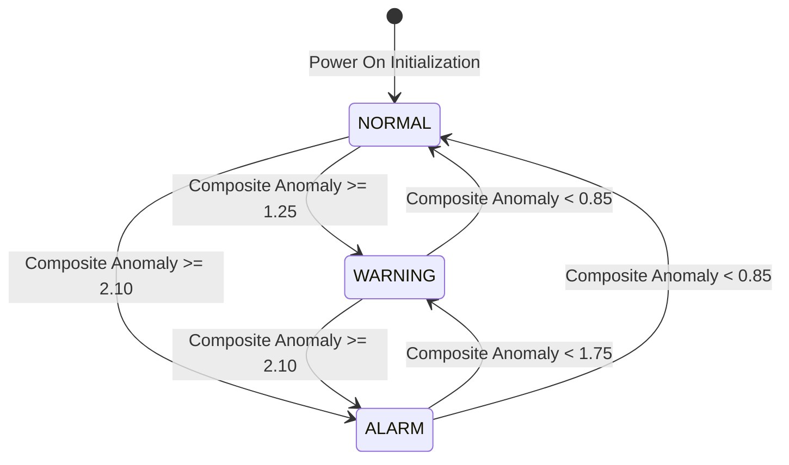
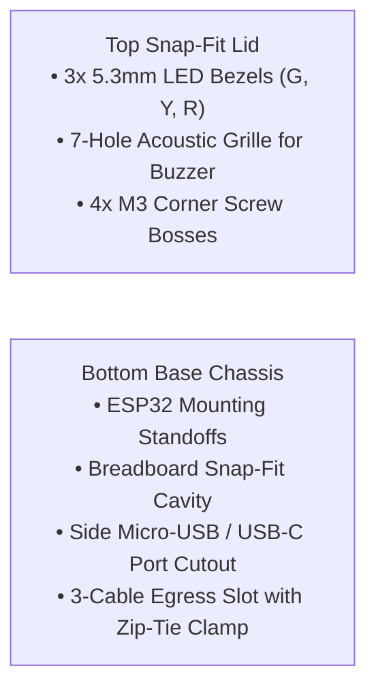

# AquaSure: Complete Technical Architecture, Signal Conditioning & Engineering Manual

> **System Classification**: Low-Cost Multi-Sensor Edge-to-Cloud Water Quality SCADA & Predictive Anomaly Screening System  
> **Target Standard**: Bureau of Indian Standards (BIS) IS 10500:2012 Drinking Water Specification  
> **Production Cloud URL**: [https://jalrakshak-rosy.vercel.app](https://jalrakshak-rosy.vercel.app)  
> **Primary Stakeholder / Client**: `devangmittal11@gmail.com`  
> **Repository**: [https://github.com/Neelkanth27/jalrakshak.git](https://github.com/Neelkanth27/jalrakshak.git) (`main` branch)

---

## 1. Executive System Overview

**AquaSure** is an industrial-grade, embedded IoT instrumentation platform designed to continuously monitor potable water safety, calculate real-time Water Quality Index (WQI) scores, identify specific chemical vs. physical contaminant signatures, and trigger multi-channel alerts (local audio-visual and remote cloud/mobile).

The system replaces manual chemical testing with automated multi-sensor edge intelligence, coupling real-time hardware telemetry to a serverless cloud data platform and Progressive Web App (PWA) SCADA console.

```mermaid
flowchart TD
    subgraph Edge_Hardware["Edge Hardware Layer (Field Instrument)"]
        Turb["SEN0189 Optical Turbidity<br/>(940nm IR Nephelometry)"] -->|ADC1_CH6 (GPIO 34)| ESP32["ESP32 DevKit V1 (240MHz Dual-Core)<br/>• 64x Multi-Sampled ADC<br/>• Exponential Moving Average (EMA)<br/>• EC25 Temp Compensation<br/>• Schmitt-Trigger State Machine<br/>• 30s Debounced Alarm Qualification"]
        TDS["Gravity Analog TDS Sensor<br/>(High-Freq AC Excitation)"] -->|ADC1_CH7 (GPIO 35)| ESP32
        Temp["DS18B20 Temp Probe<br/>(1-Wire Digital Bus)"] -->|GPIO 4 with 4.7kΩ Pull-Up| ESP32
        
        ESP32 -->|GPIO 18| LED_G["Green LED (NORMAL)"]
        ESP32 -->|GPIO 19| LED_Y["Yellow LED (WARNING)"]
        ESP32 -->|GPIO 23| LED_R["Red LED (ALARM)"]
        ESP32 -->|GPIO 5 (Active Low)| Buzz["Active 5V Buzzer (2600Hz)"]
        ESP32 -->|GPIO 0 / 13| MuteBtn["Hardware Mute Buttons"]
    end

    subgraph Cloud_Layer["Cloud Ingestion & Telemetry (Vercel + Neon)"]
        ESP32 -->|HTTPS POST + X-Device-Key| VercelAPI["Vercel Serverless API (FastAPI Python)<br/>• Route /api/telemetry<br/>• Z-Score Anomaly Engine<br/>• Euclidean Distance Matrix<br/>• Smart Contaminant Classifier"]
        VercelAPI <-->|SQLAlchemy ORM| Postgres[("Neon Serverless PostgreSQL<br/>• telemetry_records table<br/>• system_settings table<br/>• Downsampled Audit Trail")]
        VercelAPI -->|Telegram Bot API| Bot["@jalrakshak_test_bot<br/>(IST Alert Dispatcher)"]
    end

    subgraph Client_Presentation["SCADA Presentation Layer (React 18 PWA)"]
        Postgres <-->|REST & SWR Polling (3s)| PWA["React 18 SCADA Dashboard<br/>• Animated WQI Gauge (0-100)<br/>• Parameter Trend Charts<br/>• Contaminant Diagnosis Banner<br/>• 1-Click Signed PDF Certificate<br/>• CSV Audit Log Exporter<br/>• Bidirectional Remote Mute"]
        PWA -->|Mute Command| VercelAPI
        VercelAPI -->|Payload Return| ESP32
    end
```

---

## 2. Hardware Architecture & Electrical Design

### 2.1 Microcontroller Specifications
* **Chip**: Espressif ESP32-WROOM-32 (DevKit V1, 30-Pin layout).
* **Core**: Tensilica Xtensa 32-bit LX6 dual-core processor running at 240 MHz (600 DMIPS).
* **Memory**: 520 KB internal SRAM, 4 MB external QSPI Flash.
* **Networking**: 2.4 GHz 802.11 b/g/n Wi-Fi baseband with WPA2-Enterprise security.
* **ADC Subsystem**: 12-bit Successive Approximation Register (SAR) ADC on **ADC1** (GPIO 34 & GPIO 35). ADC1 is dedicated to analog sensors because ADC2 is shared with the Wi-Fi transceiver and would produce channel contention.

### 2.2 Pinout Mapping Matrix
| Component | Function | ESP32 GPIO | Electrical Protocol | Operating Voltage |
| :--- | :--- | :--- | :--- | :--- |
| **Optical Turbidity (SEN0189)** | Cloudiness / Silt | `GPIO 34` | Analog In (ADC1_CH6) | 3.3V DC |
| **Gravity Analog TDS** | Dissolved Solids | `GPIO 35` | Analog In (ADC1_CH7) | 3.3V DC |
| **Waterproof DS18B20** | Fluid Temp | `GPIO 4` | Digital 1-Wire Bus | 3.3V DC |
| **Green Status LED** | Normal State | `GPIO 18` | Digital Out (Active High) | 3.3V via 330Ω |
| **Yellow Status LED** | Warning State | `GPIO 19` | Digital Out (Active High) | 3.3V via 330Ω |
| **Red Status LED** | Critical Alarm | `GPIO 23` | Digital Out (Active High) | 3.3V via 330Ω |
| **Active 5V Buzzer** | Audible Alarm | `GPIO 5` | Active-Low Current Sink | 5V VIN / Sink to 0V |
| **Hardware Mute (BOOT)** | Mute Toggle | `GPIO 0` | Digital In (Active Low) | Internal Pull-Up |
| **Hardware Mute (Ext)** | Remote Pushbutton | `GPIO 13` | Digital In (Active Low) | Internal Pull-Up |

### 2.3 Central Breadboard Power Bus (Golden Rule Architecture)
To eliminate ground loops, phantom brownouts, and reference voltage sag:
* **The Golden Rule**: Exactly **1 wire per screw terminal** on the ESP32 expansion shield.
* **The Rail Distribution**:
  * ESP32 `3V3` terminal $\rightarrow$ Breadboard Red (+) Rail.
  * ESP32 `GND` terminal $\rightarrow$ Breadboard Blue (-) Rail.
* All sensor $V_{CC}$ and Ground connections tie directly into these central rails, maintaining an equipotential ground plane across all analog conditioning chips.

### 2.4 Detailed Sensor Schematics & Operating Principles

#### A. Optical Turbidity Sensor (SEN0189)
* **Measurement Principle**: Infrared Nephelometry ($940\text{ nm}$). An IR LED emits light through the water gap toward an optical phototransistor.
* **Optical Mechanics**: Suspended silt, clay, and colloidal solids scatter the IR beam away from the receiver. Clean water allows maximum light transmission (high phototransistor conductance $\implies$ high voltage output). Dirty water blocks transmission (low conductance $\implies$ voltage collapses toward 0V).
* **Transfer Characteristic**:
  * Clean Water ($< 5\text{ NTU}$): $V_{out} \approx 1.35\text{V} - 1.65\text{V}$ (ADC 1650–2050).
  * Turbid Water ($> 100\text{ NTU}$): $V_{out} < 0.60\text{V}$.
  * Blocked Light Path ($> 2800\text{ NTU}$): $V_{out} \approx 0.00\text{V} - 0.05\text{V}$.

#### B. Gravity Analog TDS Sensor
* **Measurement Principle**: High-Frequency AC Electrical Conductivity ($EC$).
* **Electrochemical Defense**: Direct current (DC) in water causes rapid electrolysis, plating out metal ions and destroying the probe electrodes. The Gravity driver board generates a high-frequency AC oscillation ($\sim 1\text{ kHz}$) across the two gold-plated titanium pins, measuring ionic conductance without chemical polarization.
* **3.3V Supply Saturation Ceiling**: On a 3.3V supply, the onboard LM358 operational amplifier output saturates at $V_{CC} - 1.4\text{V} \approx 1.85\text{V} - 1.90\text{V}$. This translates through the DFRobot polynomial to a physical saturation ceiling of $\approx 785 - 800\text{ ppm}$. Our firmware calibration maps this ceiling directly to the `ALARM` threshold ($> 650\text{ ppm}$).

#### C. Waterproof DS18B20 Temperature Probe
* **Measurement Principle**: Bandgap temperature sensor with digital sigma-delta analog-to-digital conversion.
* **1-Wire Bus Architecture**: Requires a single bi-directional data line (`GPIO 4`) referenced to Ground. Because the 1-Wire protocol relies on an open-drain/open-collector bus, an external **$4.7\text{ k}\Omega$ pull-up resistor** (Yellow-Violet-Red) is installed between the Data line (Yellow wire) and the $3.3\text{V}$ Rail (Red wire).
* **Resolution**: Configured for 12-bit resolution ($0.0625^\circ\text{C}$ steps, $\pm 0.5^\circ\text{C}$ accuracy).

---

## 3. Signal Conditioning & Digital Filtering Algorithms

Raw analog sensor signals in water environments suffer from high-frequency noise caused by surface ripples, microscopic bubbles, and electromagnetic induction. The firmware implements a 3-stage mathematical signal pipeline:

### 3.1 64-Sample Multisample Averaging
Every sampling cycle, the ESP32 performs 64 consecutive ADC conversions separated by $100\ \mu\text{s}$ delays:
$$V_{\text{raw}} = \left(\frac{1}{64} \sum_{i=1}^{64} \text{ADC}_i\right) \times \frac{3.3\text{V}}{4095.0}$$
This attenuates white Gaussian thermal noise and quantization error by a factor of $\sqrt{64} = 8$ (18 dB SNR improvement).

### 3.2 Exponential Moving Average (EMA) Digital Low-Pass Filter
To prevent fluid sloshing or bubbles from causing state flickering, the raw voltage is smoothed through an IIR low-pass filter:
$$V_{\text{smooth}}[k] = \beta \cdot V_{\text{raw}}[k] + (1 - \beta) \cdot V_{\text{smooth}}[k-1]$$
Where the smoothing coefficient $\beta = 0.50$. This creates an effective 3-second step response time, ensuring smooth, monotonic transitions.

### 3.3 $EC_{25}$ Fluid Temperature Compensation
The mobility of dissolved ions in water increases by approximately $+2.0\%$ per $1^\circ\text{C}$ temperature rise due to decreased fluid viscosity. To decouple seasonal or ambient temperature changes from actual chemical contamination, the raw voltage is normalized to the international standard reference temperature of $25.0^\circ\text{C}$:
$$\text{Compensation Coefficient} = 1.0 + 0.020 \times (T_{\text{fluid}} - 25.0^\circ\text{C})$$
$$V_{\text{comp}} = \frac{V_{\text{smooth}}}{\text{Compensation Coefficient}}$$

### 3.4 TDS Polynomial Inversion Formula
The temperature-compensated voltage is mapped to Total Dissolved Solids in parts per million (ppm) using the calibrated 3rd-order polynomial:
$$\text{TDS (ppm)} = \left(133.42 \cdot V_{\text{comp}}^3 - 255.86 \cdot V_{\text{comp}}^2 + 857.39 \cdot V_{\text{comp}}\right) \times 0.5$$

---

## 4. Anomaly Detection & Mathematical Formulations

### 4.1 Normalized Deviation Metrics (Z-Scores)
Rather than evaluating raw sensor values against isolated linear thresholds, the parameters are normalized into non-dimensional deviation metrics relative to pristine drinking water baselines (BIS IS 10500:2012):

$$z_{\text{turb}} = \max\left(0.0,\ \frac{\text{Turbidity (NTU)} - 10.0}{12.0}\right)$$
$$z_{\text{tds}} = \max\left(0.0,\ \frac{\text{TDS (ppm)} - 350.0}{140.0}\right)$$

### 4.2 Composite Euclidean Anomaly Score ($S_{\text{comp}}$)
The multi-dimensional risk state is calculated by projecting individual deviations onto a 2D Euclidean distance space:
$$S_{\text{comp}} = \sqrt{z_{\text{turb}}^2 + z_{\text{tds}}^2}$$

### 4.3 Unified 0–100 Water Quality Index (WQI)
The composite anomaly is converted into an intuitive, public-facing index:
$$\text{WQI} = \max\left(0.0,\ \min\left(100.0,\ 100.0 - (S_{\text{comp}} \times 25.0)\right)\right)$$

* **Grade A ($90 - 100$)**: Pristine Baseline (Pure spring / municipal tap).
* **Grade B ($75 - 89$)**: Nominal Municipal Grade (Fully potable).
* **Grade C ($50 - 74$)**: Permissible Limit Exceeded (Pre-filtration advised).
* **Grade D ($< 50$)**: Critical Hazard / Non-Potable (Unsafe for consumption).

```
   WQI Score:  0             50             75      90        100
               |--------------|--------------|-------|----------|
   Grade:      [   Grade D    ] [  Grade C   ] [  B  ] [ Grade A ]
   State:      [    ALARM     ] [  WARNING   ] [     NORMAL     ]
   LED:        [     RED      ] [   YELLOW   ] [     GREEN      ]
```

### 4.4 Smart Contaminant Fingerprint Classifier
By cross-correlating optical transmittance with electrical conductivity, the system diagnoses the root-cause nature of the contamination:
* **Severe Sediment / Particulate Intrusion**: $z_{\text{turb}} > 2.0 \land z_{\text{tds}} \le 1.5$ (Physical silt, clay, mud, pipe rust).
* **Chemical / Saline Infiltration**: $z_{\text{tds}} > 2.0 \land z_{\text{turb}} \le 1.5$ (Dissolved ionic salts, chemical fertilizer runoff, saline intrusion).
* **Severe Runoff / Surface Intrusion**: $z_{\text{turb}} > 2.0 \land z_{\text{tds}} > 2.0$ (Floodwater, raw sewage, unfiltered surface runoff).
* **Baseline / Quiescent Nominal**: $S_{\text{comp}} < 1.25$ (Clean, conforming water).

---

## 5. Control State Machine & Alarm Qualification

To eliminate false positives from accidental ripples or temporary splashes, the system runs an **Industrial Schmitt-Trigger State Machine** with a **30-Second Continuous Qualification Window**:



### 5.1 Schmitt-Trigger Hysteresis Thresholds
* **Entering WARNING**: Requires $S_{\text{comp}} \ge 1.25$.
* **Exiting WARNING**: Requires $S_{\text{comp}} < 0.85$ (Deadband $\Delta = 0.40$).
* **Entering ALARM**: Requires $S_{\text{comp}} \ge 2.10$.
* **Exiting ALARM**: Requires $S_{\text{comp}} < 1.75$ (Deadband $\Delta = 0.35$).
* *Purpose*: Prevents relay and LED chatter when water quality hovers near the decision boundary.

### 5.2 30-Second Continuous Sustained Alarm Qualification
1. **Immediate Visual Warning**: The moment $S_{\text{comp}} \ge 2.10$, the **Red LED** turns on instantly.
2. **Qualification Timer Starts**: A 30,000 ms timer begins counting continuous persistence.
3. **Sounding Condition**: The buzzer and Telegram alert will **ONLY** trigger if the water quality remains in `ALARM` continuously for 30 full seconds without resetting.
4. **Transient Filtering**: If the anomaly normalizes even for a single cycle during the 30s window (e.g. a momentary splash), the timer resets immediately to 0.

---

## 6. Cloud & Software Infrastructure

### 6.1 Serverless Cloud Architecture (Vercel + Neon Postgres)
* **Backend Framework**: Python 3.11 with FastAPI running on Vercel Serverless Functions.
* **Relational Database**: Neon PostgreSQL (Serverless, Auto-scaling in US-East).
* **Connection Pooling**: SQLAlchemy ORM with persistent session pooling.

### 6.2 Database Schema
```sql
-- Historical Telemetry Table
CREATE TABLE telemetry_records (
    id BIGSERIAL PRIMARY KEY,
    timestamp TIMESTAMP WITH TIME ZONE DEFAULT NOW(),
    device_id VARCHAR(64) NOT NULL,
    turbidity_ntu REAL NOT NULL,
    tds_ppm REAL NOT NULL,
    temp_c REAL NOT NULL,
    wqi REAL NOT NULL,
    state VARCHAR(32) NOT NULL,
    contaminant_signature VARCHAR(128)
);

-- Distributed System Settings Table (Cold-Start Persistence)
CREATE TABLE system_settings (
    key VARCHAR(64) PRIMARY KEY,
    value TEXT NOT NULL,
    updated_at TIMESTAMP WITH TIME ZONE DEFAULT NOW()
);
```

### 6.3 Zero-Trust Hardware Authentication (`X-Device-Key`)
To prevent unauthorized users from posting fake data or corrupting compliance audit logs:
* Every HTTP POST request from the ESP32 must include the custom header:  
  `X-Device-Key: jal_sec_dev_local_key`
* The API verifies this token against server environment variables before executing database queries. Unauthorized requests receive `HTTP 401 Unauthorized`.

### 6.4 Bidirectional Remote Cloud Mute / Latch
* Operators can mute a screaming buzzer remotely from the Web Dashboard or Smartphone PWA.
* The API persists `alarm_acknowledged = true` in the PostgreSQL `system_settings` table.
* On the next telemetry sync cycle (every 3 seconds), the ESP32 inspects the server's HTTP 200 response payload.
* Upon detecting `"alarm_acknowledged": true`, the firmware executes `silenceBuzzer()`.
* **Automatic Safety Reset**: When the water quality returns to `NORMAL`, the mute latch automatically resets, re-arming the buzzer for the next emergency.

---

## 7. Presentation & SCADA Web Dashboard

### 7.1 Tech Stack
* **Frontend Core**: React 18 with TypeScript.
* **Build Tool**: Vite 5.4.
* **Styling**: Tailwind CSS with custom glassmorphism, responsive mobile layout, and dark-mode industrial palettes.
* **Icons**: Lucide React.
* **PWA Engine**: Service Worker caching, offline state detection, and web app manifest for 1-tap mobile home screen installation.

### 7.2 Safety-Gated Siren Control
* **In NORMAL & WARNING**: The header Siren button is styled in neutral slate/gray, clearly displays **`Siren Armed`**, and is **disabled (`cursor-not-allowed`)**. The warning is visual-only.
* **In ALARM**: The header button unlocks, pulsates in warning red, and becomes fully clickable as **`Acknowledge & Mute Siren`** (toggling to emerald **`Buzzer Muted (Turn ON)`**).

### 7.3 Compliance Reporting Engine
* **1-Click PDF Inspection Certificate**: Implemented via `jsPDF` and `jspdf-autotable`. Generates an ISO/BIS compliance report complete with timestamp (IST), sensor telemetry table, composite anomaly score, contaminant diagnosis, and formal signature blocks.
* **CSV Audit Log Exporter**: Exports time-series historical data into Excel-compatible CSV format.

---

## 8. Mechanical Design & 3D Printed Enclosure

Located at [`docs/cad/jalrakshak_enclosure.scad`](file:///C:/Users/ATHARVA/.gemini/antigravity/scratch/jalrakshak/docs/cad/jalrakshak_enclosure.scad), the parametric enclosure provides physical protection and environmental isolation:



* **Print Settings**: Optimized for PLA / PETG with 0.20mm layer height, 20% gyroid infill, and 3 perimeter walls.
* **Acoustic Optimization**: The 7-hole grille directly aligns with the $2600\text{ Hz}$ buzzer cavity to maximize sound propagation ($> 85\text{ dB}$ at 1 meter).

---

## 9. Comprehensive Defense Guide (Viva & Stakeholder Q&A)

### Q1: Why did you power the TDS sensor from 3.3V instead of 5V?
> **Answer**: The ESP32's internal analog-to-digital converter has an input voltage ceiling of $3.3\text{V}$. Supplying the TDS conditioning board with $5.0\text{V}$ would allow its output to swing up to $\sim 3.8\text{V}$ in concentrated solutions, which would permanently burn out the ESP32's ADC multiplexer pins. By powering from the $3.3\text{V}$ rail, the maximum possible output voltage is limited to $\sim 1.85\text{V}$, ensuring absolute hardware overvoltage safety without needing external resistive dividers.

### Q2: Why use Euclidean distance instead of a simple weighted average?
> **Answer**: Weighted linear averages suffer from "masking effects"—if one parameter is within normal limits while another is at a lethal level, a linear average can produce a falsely reassuring score. Euclidean distance ($S_{\text{comp}} = \sqrt{z_1^2 + z_2^2}$) is geometrically rigorous: if *any single parameter* experiences a catastrophic spike, the quadratic term dominates, pushing the composite score into `ALARM` regardless of the other parameter.

### Q3: Why is a 30-second continuous qualification timer necessary?
> **Answer**: In real-world plumbing and storage tanks, fluid agitation, pipe turbulence, and transient bubbles cause brief, sharp voltage dips lasting 1–5 seconds. If an alarm triggered instantly, false alarms would trigger repeatedly, causing operator alert fatigue. A 30-second continuous debounce ensures that alarms only fire for true, sustained chemical or physical contamination events.

### Q4: Why did WQI rise when the temperature probe was heated?
> **Answer**: This is textbook electrochemistry ($EC_{25}$ normalization). Water conductivity naturally increases by $+2\% / ^\circ\text{C}$ because ions move faster when hot. If temperature rises without an accompanying increase in measured voltage, the algorithm mathematically deduces that the solution actually contains *fewer* dissolved ions than previously estimated, appropriately improving the Water Quality Index score.

### Q5: How does the system handle power loss or network failure?
> **Answer**: The ESP32 is completely autonomous. If Wi-Fi fails, it continues sampling sensors, executing the EMA filter, running the Schmitt-trigger state machine, and sounding the local buzzer during emergencies. On the cloud side, the PWA monitors telemetry packet timestamps: if no telemetry packet is received for $> 15\text{ seconds}$, the dashboard automatically flags the node as `● DISCONNECTED (OFFLINE)`.
