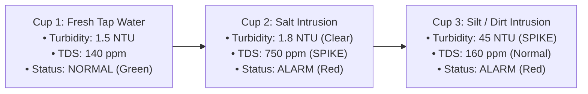

# JalRakshak — Complete Hardware Assembly, Procurement & Academic Defense Guide

This document is the end-to-end operational and technical guide for assembling the physical JalRakshak prototype, flashing the firmware, conducting live demonstrations, and defending the project before academic evaluators, teachers, and technical judges.

---

## 1. Complete Bill of Materials (BOM) & Sourcing

All components can be purchased from local hobby electronics stores (e.g., Lamington Road in Mumbai, SP Road in Bengaluru, Chandni Chowk in Delhi) or online with rapid delivery (Robu.in, ElectronicsComp.com, Amazon.in).

| Item # | Component Name | Exact Model / Specification | Purpose | Approx. Price (INR) |
| :---: | :--- | :--- | :--- | :---: |
| 1 | **Microcontroller** | ESP32 DevKit V1 (30-pin or 38-pin, NodeMCU form factor) | Dual-core MCU, Wi-Fi, ADC processing | ₹380 – ₹450 |
| 2 | **Turbidity Sensor** | Gravity Analog Optical Turbidity Sensor Module (Probe + Adapter Board) | Measures suspended solids & cloudiness (0–3000 NTU) | ₹450 – ₹600 |
| 3 | **TDS Sensor** | Gravity / Analog TDS Meter Sensor Module (Probe + Signal Board) | Measures total dissolved ionic solids (0–1000 ppm) | ₹350 – ₹480 |
| 4 | **Temperature Probe** | DS18B20 Waterproof Stainless Steel Digital Probe | Fluid temperature for $EC_{25}$ compensation | ₹120 – ₹180 |
| 5 | **Display** | 0.96 inch I2C OLED Display (SSD1306, 128x64, Blue or White) | On-device WQI gauge and status readout | ₹160 – ₹220 |
| 6 | **Pull-up Resistor** | 4.7 kΩ Resistor (1/4 Watt) | Mandatory pull-up for DS18B20 1-Wire bus | ₹2 – ₹5 |
| 7 | **Status LEDs** | 5mm LEDs: 1x Green, 1x Yellow, 1x Red | Local state indicators (Normal, Warning, Alarm) | ₹10 – ₹15 |
| 8 | **Current-Limiting Resistors** | 3x 220 Ω or 330 Ω Resistors (1/4 Watt) | Protects ESP32 GPIOs and LEDs | ₹5 – ₹10 |
| 9 | **Audio Actuator** | 5V Active Buzzer Module | Audible anomaly alarm | ₹25 – ₹40 |
| 10 | **Prototyping** | 830-point Full-Size Solderless Breadboard | Clean solderless component layout | ₹120 – ₹160 |
| 11 | **Wiring** | 40-pin Male-to-Male & Male-to-Female Jumper Wires | Connecting pins and sensor boards | ₹60 – ₹90 |
| 12 | **Power & Comm Cable** | Micro-USB (or USB-C) Data Cable (at least 1 meter) | Powers entire rig from 5V laptop USB port | ₹80 – ₹120 |
| **Total** | | | **Full Prototype Cost** | **~ ₹1,800 – ₹2,300** |

---

## 2. Complete Breadboard Pinout & Wiring Schematic

### 2.1 Power Distribution Architecture (Strictly 5V Laptop USB)
* The ESP32 DevKit is connected to the laptop's USB port via the USB data cable.
* **5V Rail**: The `VIN` (or `5V`) pin on the ESP32 supplies raw 5V directly from the laptop USB bus. Connect this to the red (+) power bus on the breadboard.
  - Turbidity Sensor Module VCC $\rightarrow$ 5V Rail
  - Active Buzzer (+) $\rightarrow$ 5V Rail (or GPIO 5 directly)
* **3.3V Rail**: The `3V3` pin on the ESP32 outputs regulated 3.3V from the onboard AMS1117 regulator.
  - TDS Sensor Module VCC $\rightarrow$ 3.3V Rail
  - DS18B20 VCC (Red wire) $\rightarrow$ 3.3V Rail
  - 0.96" OLED VCC $\rightarrow$ 3.3V Rail
* **Common Ground**: Connect the ESP32 `GND` pin to the blue (-) ground bus on the breadboard. Every sensor, LED cathode, OLED, and buzzer MUST connect to this common ground.

### 2.2 Pin-by-Pin Interconnection Matrix

```text
┌─────────────────────────────────┬───────────────────────────────┬─────────────────────────────┐
│ Component Pin                   │ ESP32 DevKit V1 Pin           │ Notes                       │
├─────────────────────────────────┼───────────────────────────────┼─────────────────────────────┤
│ Turbidity Signal (Analog OUT)   │ GPIO 34 (ADC1_CH6)            │ ADC1 pin; works with Wi-Fi  │
│ Turbidity VCC                   │ VIN (5V)                      │ From laptop USB rail        │
│ Turbidity GND                   │ GND                           │ Common ground               │
├─────────────────────────────────┼───────────────────────────────┼─────────────────────────────┤
│ TDS Signal (Analog OUT)         │ GPIO 35 (ADC1_CH7)            │ ADC1 pin; works with Wi-Fi  │
│ TDS VCC                         │ 3V3                           │ 3.3V regulated power        │
│ TDS GND                         │ GND                           │ Common ground               │
├─────────────────────────────────┼───────────────────────────────┼─────────────────────────────┤
│ DS18B20 DATA (Yellow / White)   │ GPIO 4                        │ Requires 4.7kΩ pull-up to   │
│                                 │                               │ 3.3V rail                   │
│ DS18B20 VCC (Red)               │ 3V3                           │ 3.3V regulated power        │
│ DS18B20 GND (Black)             │ GND                           │ Common ground               │
├─────────────────────────────────┼───────────────────────────────┼─────────────────────────────┤
│ OLED SDA                        │ GPIO 21                       │ Hardware I2C SDA            │
│ OLED SCL                        │ GPIO 22                       │ Hardware I2C SCL            │
│ OLED VCC                        │ 3V3                           │ 3.3V regulated power        │
│ OLED GND                        │ GND                           │ Common ground               │
├─────────────────────────────────┼───────────────────────────────┼─────────────────────────────┤
│ Green LED Anode (+)             │ GPIO 18 (via 220Ω resistor)   │ Normal Water Quality State  │
│ Yellow LED Anode (+)            │ GPIO 19 (via 220Ω resistor)   │ Warning / Drift State       │
│ Red LED Anode (+)               │ GPIO 23 (via 220Ω resistor)   │ Critical Alarm State        │
│ LED Cathodes (-)                │ GND                           │ Direct to common ground     │
├─────────────────────────────────┼───────────────────────────────┼─────────────────────────────┤
│ Buzzer (+)                      │ GPIO 5                        │ Switched alarm output       │
│ Buzzer (-)                      │ GND                           │ Common ground               │
└─────────────────────────────────┴───────────────────────────────┴─────────────────────────────┘
```

> [!IMPORTANT]
> **Why GPIO 34 and GPIO 35?**
> The ESP32 contains two Analog-to-Digital Converters (ADC1 and ADC2). When the ESP32 Wi-Fi radio is actively transmitting, **ADC2 is hardware-locked** by the Wi-Fi driver. Using ADC2 pins (like GPIO 2, 4, 12, 14, 15) for analog sensors will cause them to return 0 or corrupt values once Wi-Fi starts. GPIO 34 and GPIO 35 belong to **ADC1**, guaranteeing uninterrupted analog sampling during live cloud transmission.

---

## 3. Step-by-Step Firmware Flashing Guide

You can flash the firmware using either **Arduino IDE** (recommended for quick evaluation) or **PlatformIO in VS Code**.

### Method A: Arduino IDE (Recommended & Easiest)

1. **Install Arduino IDE**: Download and install [Arduino IDE 2.x](https://www.arduino.cc/en/software).
2. **Add ESP32 Board Support**:
   - Go to **File $\rightarrow$ Preferences**.
   - In *Additional Boards Manager URLs*, paste:
     ```text
     https://raw.githubusercontent.com/espressif/arduino-esp32/gh-pages/package_esp32_index.json
     ```
   - Go to **Tools $\rightarrow$ Board $\rightarrow$ Boards Manager**, search for `esp32`, and click **Install** (by *Espressif Systems*).
3. **Install Required Libraries**:
   - Go to **Tools $\rightarrow$ Manage Libraries** (or `Ctrl+Shift+I`).
   - Search and install each of the following (install all dependencies when prompted):
     1. `Adafruit SSD1306` (by Adafruit)
     2. `Adafruit GFX Library` (by Adafruit)
     3. `OneWire` (by Paul Stoffregen)
     4. `DallasTemperature` (by Miles Burton)
     5. `ArduinoJson` (by Benoit Blanchon, version 6.x or 7.x)
4. **Open the Sketch**:
   - Open `firmware/firmware.ino` in Arduino IDE.
5. **Configure Wi-Fi Credentials**:
   - On lines 36–37, enter your phone's personal hotspot name and password:
     ```cpp
     const char* WIFI_SSID     = "MyPhoneHotspot"; 
     const char* WIFI_PASSWORD = "MyPassword123";
     ```
6. **Flash the ESP32**:
   - Plug the ESP32 DevKit into your laptop via Micro-USB.
   - Go to **Tools $\rightarrow$ Board $\rightarrow$ esp32 $\rightarrow$ DOIT ESP32 DEVKIT V1**.
   - Go to **Tools $\rightarrow$ Port** and select your ESP32 COM port (e.g., `COM3`, `COM4`, or `COM5`).
   - Click the **Upload** arrow button (or `Ctrl+U`).
   - *Tip*: If the terminal shows `Connecting........_____.....`, press and hold the **BOOT** button on the ESP32 for 2 seconds until the upload starts.

---

## 4. Live Demonstration Protocol for Judges & Teachers

Prepare **three small clear plastic cups** on the table next to the laptop. This gives you a seamless, dramatic 3-stage presentation:



### Stage 1: Clean Baseline (Tap Water)
1. Immerse all three sensor probes (Turbidity, TDS, Temp) into **Cup 1** (ordinary drinking or tap water).
2. **Observe**:
   - The ESP32 OLED shows: `WQI: 96/100`, `State: NORMAL`, `Turb: 1.8 NTU`, `TDS: 145 ppm`.
   - The **Green LED** illuminates. Buzzer is silent.
   - On your laptop browser at `https://jalrakshak-rosy.vercel.app` and on your mobile phone PWA, the dial sits at 96% in the vibrant green zone ("Grade A — Pristine Baseline").

### Stage 2: Chemical / Saline Intrusion (Salt Water)
1. Add 1/4 teaspoon of table salt to **Cup 2** and stir. Move the probes into Cup 2.
2. **Observe**:
   - The fluid looks completely clear to the naked eye (Turbidity stays nominal at ~2 NTU).
   - The TDS reading immediately spikes to **>700 ppm**!
   - The ESP32 sounds the **Buzzer**, the **Red LED** turns on, and the OLED shows: `WQI: 34/100`, `State: ALARM`.
   - The live web dashboard updates in real time to Red Alert.
   - The "Smart Contaminant Diagnosis" banner classifies it as: **Chemical / Saline Infiltration**.
   - Your smartphone immediately buzzes with a rich Telegram notification from `@jalrakshak_test_bot`!
3. **Presenter Talking Point**:
   > *"Notice that this water looks perfectly clear to the human eye, but our sensor fusion immediately detected a massive dissolved chemical and mineral surge, protecting consumers before anyone drinks it."*

### Stage 3: Suspended Sediment Intrusion (Silty Water)
1. Add a small pinch of soil, sand, or a single drop of milk to **Cup 3**. Move the probes into Cup 3.
2. **Observe**:
   - Turbidity spikes to **>35 NTU**, while TDS stays relatively moderate (~160 ppm).
   - The system re-classifies the anomaly as: **Severe Sediment / Particulate Intrusion**.
   - The live dashboard updates, and the 1-click **Export Audit Certificate (PDF)** button generates an executive inspection report for the trial.

---

## 5. Technical Defense Cheat Sheet for Evaluators

When teachers, professors, or technical judges interrogate the project, use these precise scientific answers:

### Q1: "Why did you choose an ESP32 instead of an Arduino Uno or Raspberry Pi?"
> **Answer**:
> *"The ESP32 gives us the optimal balance of real-time embedded deterministic control and cloud edge capability. Unlike the 8-bit Arduino Uno (which has only 2KB of RAM, 16MHz clock speed, and no network stack), the ESP32 provides a dual-core 32-bit Xtensa processor running at 240MHz. This allows Core 0 to handle Wi-Fi and TLS/HTTPS cryptography (`WiFiClientSecure`) while Core 1 performs 64x oversampled analog signal conditioning and OLED rendering with zero latency. A Raspberry Pi was rejected because it draws 5W to 15W, requires an operating system, and lacks native hardware ADCs, making it over-engineered and incapable of running directly from a laptop's 2.5W USB port."*

### Q2: "How do you handle temperature dependency in TDS / Electrical Conductivity?"
> **Answer**:
> *"Electrical conductivity in aqueous solutions increases by approximately 2% per degree Celsius due to decreased fluid viscosity and heightened ionic velocity. Without compensation, identical water would read artificially higher on a hot afternoon than on a cold morning. We implement standard $EC_{25}$ benchmark normalization:
> $$EC_{25} = \frac{EC_T}{1.0 + \alpha(T - 25.0)}$$
> where $\alpha = 0.02 / ^\circ\text{C}$ and $T$ is sampled in real time by the DS18B20 digital 1-Wire probe located directly alongside the electrodes."*

### Q3: "What mathematical formulation powers your Anomaly Detection and WQI?"
> **Answer**:
> *"We compute standardized Z-scores against a baseline $(\mu, \sigma)$ determined during calibration:
> $$z_i = \frac{x_i - \mu_i}{\max(\sigma_i, s_{i,min})}$$
> A critical engineering defense is the minimum variance guard $s_{i,min} \ge 0.05 \cdot \mu_i$, which prevents division-by-zero numerical explosions when water remains perfectly stationary. The composite Euclidean distance $S = \sqrt{z_{turb}^2 + z_{tds}^2}$ maps directly to our 0–100 Water Quality Index:
> $$\text{WQI} = \max(0, \min(100, 100 - (S \times 25)))$$
> Categorical state changes trigger local actuators (LEDs, Buzzer) and push cloud notifications via an asynchronous alert worker with hysteresis to prevent flapping."*

### Q4: "Describe your Cloud, Backend, and DevOps pipeline."
> **Answer**:
> *"Our project adheres to Twelve-Factor Cloud principles. The microcontroller authenticates via a secured `X-Device-Key` header over HTTPS. The cloud tier is a serverless Python FastAPI engine deployed on Vercel with automatic global edge distribution. Data persistence uses a managed Neon PostgreSQL database in AWS with SSL connection pooling. The presentation tier is a Progressive Web App (PWA) built in React 18, TypeScript, and Tailwind CSS, deployable on mobile devices with standalone homescreen icons. Continuous Integration is automated via GitHub Actions, running linting and unit test verification on every commit."*
